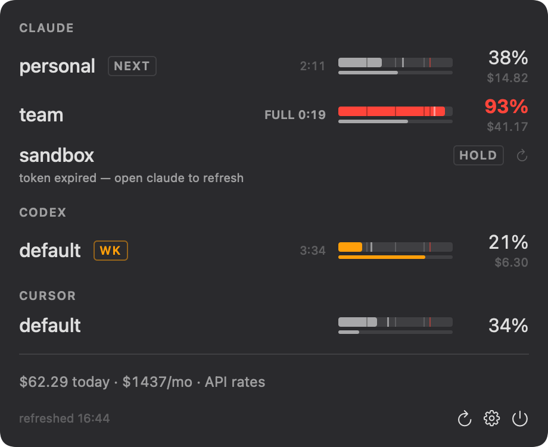

# AgentBar

A macOS menu bar app that shows Claude Code, Codex, and Cursor usage limits across multiple accounts.

The menu bar icon shows the most-constrained account.
The dropdown lists every account with session and weekly meters, reset countdowns, a pace projection, and a usage history sparkline.
It also shows the Anthropic, OpenAI, and Cursor status pages.
AgentBar can notify you when an account nears a limit and suggest the account with the most headroom.

AgentBar is an unofficial tool.
Anthropic, OpenAI, and Cursor do not make or endorse it.
It uses undocumented usage endpoints that can change or break without notice.

## Requirements

- macOS 14 or later
- Swift 6.1 or later (Xcode 16.3 or later)

## Build and install

    make install    # builds dist/AgentBar.app and copies it to /Applications

Other targets:

    make test       # run the test suite
    make app        # build dist/AgentBar.app only
    make zip        # build and zip the app to dist/AgentBar.zip

Optional: run `Packaging/make-signing-cert.sh` once per machine to create a local "AgentBar Dev" code-signing certificate.
It keeps the app's signature stable across rebuilds.
The script asks for your login keychain and admin passwords, so run it in a terminal.
Without it, `make app` signs the app ad-hoc.

An app built on another machine is not notarized.
To open it, approve it once in System Settings > Privacy & Security ("Open Anyway").

## Accounts

AgentBar discovers accounts on its own:

- Claude Code: every `~/.claude*` config directory
- Codex: every `~/.codex*` home directory
- Cursor: the signed-in Cursor app (Grok Bot uses the same account and shows as the weekly meter)

In Settings you can rename, hide, or add accounts, set the refresh interval, turn on launch at login, and turn on notifications.
AgentBar stores its config at `~/Library/Application Support/AgentBar/config.json`.

## Privacy and credentials

AgentBar reads the credentials that each CLI or app already stores on your Mac:

- Claude Code: the OAuth token in the macOS Keychain (or `.credentials.json` in the config directory).
  AgentBar reads it through Apple's `/usr/bin/security` tool and never refreshes or writes it.
  When a token expires, run `claude` once and the row recovers.
- Codex: `auth.json` in the Codex home.
  When the access token expires, AgentBar refreshes it the same way the Codex CLI does and writes the new token back to `auth.json`.
- Cursor: the access token in Cursor's local `state.vscdb`, opened read-only.

Each token goes only to its own provider:

- `api.anthropic.com` for Claude usage
- `chatgpt.com` and `auth.openai.com` for Codex usage and token refresh
- `cursor.com` and `api2.cursor.sh` for Cursor and Grok Bot usage

AgentBar also reads the public status pages at `status.claude.com`, `status.openai.com`, and `status.cursor.com`.
Cost estimates come from the local Claude Code and Codex session logs.
Usage history stays in `~/Library/Application Support/AgentBar/history`.
AgentBar has no analytics and sends nothing anywhere else.

## Development

    swift test
    swiftlint lint --quiet    # must report zero violations

`AgentBarCore` holds the fetchers, parsers, and presentation logic, and every dependency is injectable.
Tests never touch the network, the real Keychain, or your home directory.
`AgentBar` is the SwiftUI app.
See `CLAUDE.md` for the invariants and gotchas.

## License

MIT. See `LICENSE`.
Parts of the usage-fetching logic come from [CodexBar](https://github.com/steipete/CodexBar) (MIT); see `NOTICE`.
